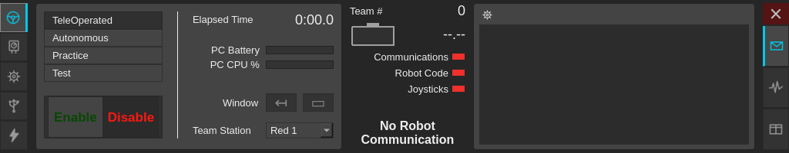
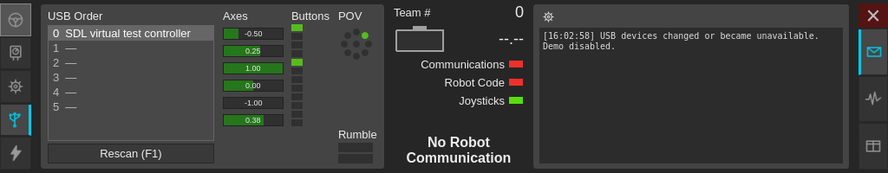
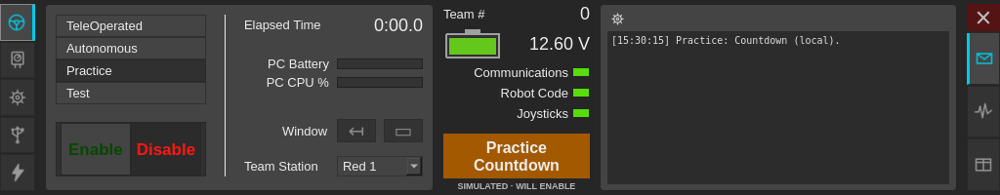

# DriveStation Linux

**0.11.0-alpha.1 — ALFA / VERSÃO DE TESTES EM DESENVOLVIMENTO.**

Esta versão ainda não é final ou homologada. A compatibilidade física com
NI 26.0/roboRIO não foi validada; os testes de rede usam um par próprio em loopback.

Reimplementação independente para Linux da **NI FRC Driver Station**, com foco
em fidelidade visual e funcional à experiência usada com **roboRIO**.

**Estado atual: prévia desktop com Practice local, entrada SDL2 e UDP/TCP experimental na interface.**
Controles são detectados em seis slots, com eixos, botões, POV e teste de rumble.
A integração foi exercitada com dispositivos virtuais SDL; modelos físicos ainda
precisam de validação. A interface envia comandos e entradas ao destino IPv4
informado explicitamente; os testes usam um par UDP em loopback. A compatibilidade
física com roboRIO ainda não foi validada. O TCP envia descritores e Game Data,
e recebe console, erros e versões do par de teste. A alfa 0.8.0 acrescenta
data/hora UTC e fuso no UDP, além do pacote de download identificado como testes.
A 0.9.0 acrescenta busca mDNS IPv4 por equipe, com seleção manual do endereço.
A alpha.2 preserva os limites entre rótulos DNS na comparação dos nomes, evitando
que um ponto literal em um rótulo seja confundido com um separador.
A 0.10.0 acrescenta gráficos das respostas UDP aceitas e exportação manual de
diagnósticos de rede em JSON, com histórico limitado e separação da simulação.
A 0.11.0 permite trocar os seis slots USB e restaurar a ordem de controles que
informem GUID e serial, sem usar o índice temporário do dispositivo como identidade.



## Objetivo

Permitir que equipes FRC usem Linux mantendo uma experiência próxima da Driver
Station da NI: disposição dos controles, indicadores, modos de operação,
joysticks, diagnóstico e configuração.

A fidelidade será avaliada em duas frentes: comparação da interface com a
referência e testes do comportamento com simuladores e, posteriormente, com
roboRIO. Cada recurso terá seu estado registrado na
[matriz de fidelidade](docs/fidelidade.md).

## Referência do projeto

A referência inicial é a **NI FRC Driver Station da temporada 2026 para
roboRIO**, versão **26.0**, confirmada pelo dono. Capturas dessa versão passaram
a orientar a paleta; veja a [pesquisa visual](docs/decisoes/0004-paleta-ni26.md).
Não há código-fonte da NI incorporado neste repositório.

A [FIRST Driver Station anunciada para 2027][nova-ds] já oferece suporte a Linux,
mas foi projetada para Systemcore e não é compatível com roboRIO. Este projeto
tem como alvo a experiência anterior da NI e o ecossistema roboRIO.

## Compilar e executar

Dependências: compilador C++17, CMake 3.21 ou posterior, Ninja e os módulos
Widgets, Network e Test do Qt 6.4 ou posterior, além de SDL2 2.24 ou posterior.
Não há downloads automáticos no build.
O ambiente local validado é Arch Linux x86_64 com Qt 6.12.0 e GCC 16.2.1.
O CI também passou no Ubuntu 24.04 com Qt 6.4.2; a versão 6.4.0 exata não foi testada.

No Ubuntu 24.04:

```sh
sudo apt-get install cmake ninja-build g++ qt6-base-dev libsdl2-dev
```

```sh
cmake -S . -B build -G Ninja -DCMAKE_BUILD_TYPE=Release
cmake --build build --parallel
ctest --test-dir build --output-on-failure
./build/drivestation-linux
```

Para instalar no diretório do usuário:

```sh
cmake --install build --prefix "$HOME/.local"
```

O binário será instalado em `~/.local/bin`, junto de um atalho de desktop e um
ícone nos diretórios correspondentes. O binário depende do Qt e do SDL2 instalados.

## Pacote alfa para testes

Extraia o arquivo `drivestation-linux-0.11.0-alpha.1-linux-x86_64-TESTES.tar.gz`
inteiro e abra `INICIAR-ALFA.sh`. `LEIA-ME-ALFA.txt` explica o estado de testes e
as dependências; `build-info.json` identifica a versão e as bibliotecas do build.
O título e o status da janela exibem **ALFA**. O pacote não inicia conexão sozinho.

Este arquivo usa Qt/SDL do sistema, sem instalação como root. Não é um AppImage
e não inclui essas bibliotecas. O build local foi verificado no Arch Linux
x86_64 com Qt 6.12.0 e glibc 2.44; outras distribuições ainda precisam de validação.
O workflow gera um build separado para Ubuntu 24.04; confira os metadados de cada arquivo.

Para gerar um pacote a partir de um build Release testado:

```sh
cpack --config build/CPackConfig.cmake -G TGZ -B dist
```

CPack gera também o SHA256. O verificador de desenvolvimento requer Python 3.12
ou posterior, extrai em uma pasta nova e testa os executáveis do próprio arquivo:

```sh
python3 packaging/verify-alpha.py dist/drivestation-linux-0.11.0-alpha.1-linux-x86_64-TESTES.tar.gz /tmp/drivestation-alpha-check
```

## Usar a prévia

- As abas à esquerda são Operation, Diagnostics, Setup, USB Devices e CAN/Power.
- À direita, Messages, Charts e Both alternam a visualização.
- Setup salva equipe, dashboard, dados de jogo e tempos de prática. A seleção
  de dashboard é uma preferência; não inicia outro aplicativo neste marco.
- A engrenagem do console abre os controles e a conexão UDP/TCP; `F10` também abre esse menu.
- **Simulate robot**, nesse menu, ativa dados gerados localmente. Enable/Disable e E-Stop
  alteram apenas essa demonstração. Não são enviados comandos ao robô.
- `Enter` desabilita a demonstração; `Space` trava E-Stop dentro da aplicação.
  Segurar `[`, `]` e `\` habilita a demonstração fora dos campos de texto.
- **Reset demo** limpa a sessão e a desconecta. Reconectar, mudar modo, equipe
  ou estação não reabilita a demonstração automaticamente.

## Controles no Linux

Na aba **USB Devices**, selecione um dos seis slots para inspecionar a entrada.
Conectar ou remover um dispositivo atualiza a lista; os demais mantêm seus índices.
**Rescan** e `F1` repetem a descoberta. Dispositivos excedentes aguardam um slot livre.

As setas **↑/↓** trocam o slot selecionado com o vizinho, incluindo slots vazios
ou reservados. A seleção acompanha o controle movido. A troca interrompe rumble,
cancela Practice/Enable e envia Disable antes de alterar os dados e descritores
dos controles na rede. Voltar a operar exige um novo Enable explícito.

Se o SDL informar GUID não nulo e serial, a ordem usa uma chave SHA-256 desses
valores nas preferências locais; o serial não é gravado em claro. Identidades
repetidas entre dispositivos conectados não produzem reservas. Sem serial ou
identidade suficiente, as trocas valem somente na sessão; não há inferência por
nome, caminho `/dev/input`, GUID isolado ou índice de enumeração.
Essas identidades são informações do driver, não autenticação do dispositivo.

Um controle ausente mantém o slot marcado **[reserved]**; outro dispositivo não
o ocupa automaticamente. **F10 → Forget missing USB reservations** libera somente
as reservas sem controle conectado, desabilitando a operação antes. Dispositivos
em espera podem ocupar os slots liberados na próxima descoberta. O tooltip informa
se a posição foi salva ou se vale apenas na sessão. A restauração depende de o
driver continuar informando a mesma identidade; modelos físicos ainda precisam
de validação. Não há remapeamento NI/XInput neste incremento.

A tela mostra os seis primeiros eixos normalizados em −1…1, os doze primeiros
botões e o primeiro POV. O tooltip informa os totais. A leitura conserva até
256 entradas de cada tipo, sem remapeamento automático para Xbox. Os números
são os índices do dispositivo, não uma confirmação de equivalência ao mapeamento
que a NI aplica a cada controle.

As barras de **Rumble** ficam disponíveis quando o dispositivo informa suporte.
Mantenha a barra pressionada para testar; a superior corresponde ao motor direito
(alta frequência) e a inferior ao esquerdo (baixa frequência). Liberar, mudar de
slot ou aba, perder ativação, desconectar ou fechar interrompe o efeito.
Os comandos pedem duração de 100 ms e são renovados enquanto a barra está pressionada;
a duração física depende do driver e do dispositivo. Falha no efeito o desabilita
até um novo Rescan ou reconexão.

**Joysticks** indica entrada Linux disponível, independentemente da simulação do
robô. Mudança de dispositivos ou perda de leitura cancela a sessão demonstrativa,
inclusive Practice em espera. Selecionar outro slot apenas muda a inspeção.
A demo não cria dispositivos, eixos ou botões fictícios. Nenhuma permissão de
`/dev/input` é alterada pelo aplicativo.



Veja a [decisão de entrada](docs/decisoes/0005-entrada-sdl.md) e os
[resultados e limites dos testes](docs/validacao-usb.md).

## Verificar a comunicação UDP local

A versão 0.5.0 inclui uma biblioteca de comunicação separada e um verificador
sem janela gráfica:

```sh
./build/drivestation-network-check
./build/drivestation-network-check --json
```

O comando cria dois sockets em **127.0.0.1**, em portas efêmeras, e encerra com
código zero quando passa. Ele verifica entradas de controles, habilitação explícita,
resposta de estado/bateria, timeout, reconexão desabilitada e E-Stop travado.
Não aceita destino externo e não precisa de um roboRIO ou acesso administrativo.

O perfil experimental usa o formato UDP versão 1 documentado para roboRIO:
sequência, modos, estação, eixos, botões, POV, bateria e saídas de joystick.
As respostas precisam corresponder a envios recentes, vir da origem configurada
e avançar a sequência. Pacotes inválidos ou repetidos não renovam a conexão.

O watchdog local é de 250 ms; atraso de envio de 100 ms também cancela a
habilitação. Esses são limites da implementação, sem garantia de tempo real do
sistema operacional ou declaração sobre os limites do firmware NI.

O verificador não captura USB. A interface pode usar uma sessão UDP separada da
demonstração, descrita abaixo. Nenhuma das duas aplica rumble recebido.
O TCP, o relógio e a busca de endereço são descritos a seguir. O perfil foi testado com
um par próprio, não com capturas NI 26.0 ou firmware roboRIO 2026.
Veja a [decisão técnica](docs/decisoes/0006-transporte-udp.md) e a
[validação de rede](docs/validacao-rede.md).

## Conectar pela interface — alfa experimental

Abra a engrenagem ou `F10` e selecione **Robot connection (UDP/TCP)...**. Informe o
IPv4 literal e as portas. O destino inicial é `127.0.0.1`, porta 1110; a porta
local padrão é 1150. Porta local 0 escolhe uma porta efêmera para testes.
O campo IPv4 continua explícito. A busca por equipe pode ajudar a preenchê-lo,
sem conectar ou habilitar automaticamente.

**Find roboRIO** consulta `roborio-<equipe>-frc.local` com mDNS IPv4 one-shot, sem
Avahi/NSS obrigatório. A busca envia até duas consultas por interface IPv4 ativa
com multicast e tem prazo local de 2,5 segundos. IPv6, CNAME e navegação DNS-SD
contínua não são implementados nesse perfil.

A lista distingue **mDNS response** de sugestões **USB hint** (`172.22.11.2`) e
**TE.AM hint** (`10.TE.AM.2`, para equipes 1–25599). Sugestões não são sondadas;
uma resposta mDNS também não autentica a identidade nem valida o protocolo do robô.
Equipes até 65535 podem consultar o hostname, mas não recebem TE.AM inválido.

Não há seleção automática. Escolha uma linha e pressione **Use selected address**
para preencher IPv4; depois, **Connect** inicia o transporte desabilitado. **Enable**
continua separado. A busca é bloqueada enquanto o transporte estiver ativo.
Trocar equipe/endereço, fechar o diálogo, Connect/Disconnect ou ativar a demo cancela
a busca. Resultados mDNS expiram em até dez segundos e precisam estar válidos ao
aplicar; no máximo dezesseis endereços ficam na lista. O código verifica ID,
pergunta, origem/porta e comprimentos antes de aceitar a resposta.

A busca foi exercitada com um respondedor próprio em loopback, não em rede física
com roboRIO. Sua resposta e os hints não substituem a validação UDP/TCP ao conectar.

**Use TCP** vem marcado, com porta padrão 1740 no mesmo IPv4. O aplicativo inicia
o TCP depois da primeira resposta UDP válida; em caso de falha, tenta novamente
com intervalo mínimo de um segundo enquanto a sessão UDP estiver conectada.
Desmarcar **Use TCP** seleciona explicitamente o perfil anterior, somente UDP.

**Connect** encerra a demo e inicia o envio desabilitado. Só uma resposta válida,
recente e com código disponível permite um **Enable** explícito. Com TCP ativo,
também é necessário que o snapshot local de descritores/dados tenha sido enviado
ao socket; isso não significa confirmação de interpretação pelo robô. Teleop,
Autonomous e Test enviam comandos; Practice e A-Stop continuam exclusivos da
demo. Os seis slots SDL seguem seus índices, incluindo tags vazias para slots
ausentes. Entradas além de 12 eixos, 32 botões ou 12 POVs, ou POV inválido,
cancelam a habilitação e bloqueiam novo Enable até corrigir a entrada. Não há
truncamento silencioso.

O TCP envia os seis descritores, inclusive slots vazios, e Game Data ao conectar
e quando esses metadados mudam. Os nomes usam UTF-8 com limite de 255 bytes;
nomes incompatíveis bloqueiam Enable. A ordem e as contagens correspondem à
entrada SDL. O tipo de controle é desconhecido (`-1`), `Is Xbox` é falso e os
usos dos eixos são desconhecidos (`0xff`): ainda não há equivalência NI/XInput.
Game Data usa até 1024 bytes UTF-8 e alterações cancelam a habilitação.

Bateria, Communications, Robot Code e modo/habilitação exibidos vêm da resposta
UDP. **Waiting for Enable/Disable** distingue o pedido local da confirmação do
par. Diagnostics mostra TX/RX, rejeições e RTT. O cronômetro mede o pedido local
de Enable. Charts mostra RTT medido e bateria dessas respostas, identificados
como **received UDP**, com amostragem a cada 200 ms e até 3000 pontos. Pacotes
rejeitados não viram amostras. Perdas de comunicação separam os segmentos do
gráfico, e o eixo de tempo continua avançando durante a ausência de respostas.
A escala de RTT se ajusta aos dados visíveis; o tooltip mostra os últimos valores.
Trocar de fonte ou iniciar outra conexão limpa o gráfico.

**F10 → Export network diagnostics...** salva um JSON da sessão de rede atual,
ou da última conexão após Disconnect. A ação fica indisponível na demo. O diálogo
sugere Downloads; só há escrita após escolher o arquivo. A operação é desabilitada
antes do diálogo e da gravação, inclusive se houver cancelamento ou erro de escrita;
retomar exige Enable explícito. O arquivo usa substituição atômica via QSaveFile.
O formato `drivestation-linux-diagnostics` versão 1 inclui versão do aplicativo,
horários UTC, destino, contadores, erros, amostras e até 256 mensagens/eventos de
rede. Campos textuais são limitados a 2048 caracteres, com indicador de truncamento;
contadores informam descartes pelo limite do histórico. Outra conexão reinicia esse
histórico. Não grava as entradas brutas dos controles, o campo Game Data ou dados da demo.
É um formato próprio, sem compatibilidade com o leitor ou os logs binários da NI.

Messages recebe stdout, warnings e erros TCP com sequência, tempo informado pelo
par, código, localização e stack. O conteúdo é texto simples; controles não
imprimíveis são substituídos. Diagnostics mostra as versões recebidas de
`roboRIO image` e `FRC_Lib_Version`; demais versões aparecem no console. Desconectar
limpa os dados de versão anteriores. Há limite de 32 registros de versão e 200
blocos de console.

O parser trata fragmentação e concatenação do stream, heartbeat vazio e tags
desconhecidas. O perfil limita frames a 8192 bytes incluindo ID, buffer a 16388
bytes, fila de envio a 16384 bytes, e recepção a 512 frames e 256 KiB por segundo.
Conexão sem sucesso após 1500 ms, frame incompleto após 1000 ms, excesso de dados
ou tag conhecida malformada encerram o TCP. Esses são limites locais, sem garantia
de tempo real. A queda ou ressincronização TCP cancela Enable mesmo com UDP ativo;
reconectar e reenviar metadados nunca reabilita automaticamente.

O UDP inclui data/hora UTC e fuso do sistema na primeira transmissão. Um pedido
`0x01` em resposta válida recente, ou reconexão após perda de comunicação, agenda
novo envio com intervalo mínimo de um segundo. Pacotes inválidos, repetidos ou de
outra origem não agendam esse envio. Sem pedidos ou reconexão, o relógio não é
reenviado periodicamente. Ano válido no fio: 1900–2155; janeiro é zero.
O campo de microssegundos usa a precisão de milissegundos disponível no Qt.
Fuso: identificador do sistema, até 128 bytes ASCII imprimíveis sem espaços.
O perfil envia data e fuso juntos; sua interpretação física ainda não foi validada.
Isso não ajusta o relógio do computador. Watchdogs usam tempo monotônico e não
dependem de mudanças no relógio de parede; erro ao obter o horário encerra o link.

Disable/Enter, perda de foco, ocultação, abertura do diálogo de conexão, mudança
de modo/equipe/estação/tempos, perda de leitura ou mudança de USB cancelam a
habilitação. Timeout ou atraso de envio também exigem novo Enable. **E-Stop/Space**
permanece travado na sessão UDP até encerrar o aplicativo, inclusive após
Disconnect/Connect, troca para demo e Reset demo. A resposta do robô nunca limpa
essa trava.

**Disconnect** e fechamento tentam enviar um último pacote desabilitado; UDP
não garante a entrega. Endereço, portas, conexão e habilitação não são persistidos;
reabrir inicia sem tráfego. Após Disconnect, **Simulate robot** permite voltar à demo.
Os testes automatizados só se conectam a `127.0.0.1`, com backend de controles
de teste. Não houve conexão a um robô físico nesta etapa.

## Practice na demonstração

Abra a engrenagem (ou `F10`), ative **Simulate robot**, selecione **Practice** e pressione **Enable**. Os tempos
de Setup controlam os cinco segmentos consecutivos: Countdown → Autonomous →
Delay → Teleoperated → End Game. O último segmento continua em Teleop. Os padrões
existentes são preservados; eles não definem as regras de duração de uma temporada.

Countdown e Delay ficam desabilitados. Os outros segmentos habilitam a sessão
local e a sequência termina desabilitada. O cronômetro inclui as esperas;
seu tooltip mostra o tempo restante do segmento.

O botão **A-Stop**, no menu, e `Backspace`, fora dos campos de texto, interrompem somente
Autonomous. O relógio continua e Teleop retoma automaticamente. O status laranja
e **WILL ENABLE** indicam habilitação futura.

**Disable** ou `Enter` cancelam tudo, inclusive Countdown e A-Stop. E-Stop,
desconexão, perda de ativação da janela, fechamento, mudança de dispositivos USB, troca de modo, equipe,
estação ou tempos também interrompem a execução. Um atraso de atualização maior
que um segundo cancela a sessão em vez de avançar silenciosamente pelas fases.
Nada é retomado sem um novo Enable explícito, exceto a retomada prevista de um
A-Stop ainda em execução.



Veja as capturas de [A-Stop](docs/images/ni26-practice-astop.png) e
[Teleop retomado](docs/images/ni26-practice-teleop.png), a
[decisão de comportamento](docs/decisoes/0002-practice-local.md) e a
[validação](docs/validacao-practice.md).

O aplicativo inicia desconectado e desabilitado. Estado de conexão, habilitação
e E-Stop não são persistidos. As preferências usam `QStandardPaths` e ficam,
normalmente, em `~/.config/DriveStationLinux/drivestation-linux/settings.ini`.

```sh
./build/drivestation-linux --demo --tab usb --view both
./build/drivestation-linux --config /tmp/drivestation-settings.ini
QT_QPA_PLATFORM=offscreen ./build/drivestation-linux --screenshot /tmp/drivestation-preview.png
```

`--screenshot` requer um caminho novo e preserva arquivos existentes.
Veja também [Setup](docs/images/ni26-setup.png), [USB sem dispositivos](docs/images/ni26-usb-empty.png) e
o [menu de controles locais](docs/images/ni26-menu.png).

## Desenvolvimento e limitações

O painel tem 200 pixels lógicos de altura e largura
mínima de 1024 pixels. O layout usa como referência inicial as imagens da
documentação WPILib e capturas da NI 26.0. A comparação completa de todas as
abas com essa versão continua pendente.

Não há captura de teclado fora da aplicação, ordenação persistente de controles,
integração com dashboards ou encaixe automático da janela. Campos sem fonte de dados exibem indisponibilidade.
Sons de Practice, suspensão física e a paridade exata com a NI ainda não foram
validados. O protocolo UDP experimental tem testes próprios; compatibilidade física e
paridade completa com a NI permanecem sem validação.

- [Matriz de fidelidade](docs/fidelidade.md)
- [Plano de desenvolvimento](docs/roadmap.md)
- [Referências técnicas](docs/referencias.md)
- [Decisão de stack e critérios da prévia](docs/decisoes/0001-desktop-qt.md)
- [Ajustes de fidelidade visual](docs/decisoes/0003-fidelidade-visual.md)
- [Pesquisa e correção da paleta NI 26.0](docs/decisoes/0004-paleta-ni26.md)
- [Validação da correção 0.3.1](docs/validacao-ni26.md)
- [Validação da interface 0.3.0](docs/validacao-visual.md)
- [Validação da primeira prévia](docs/validacao-previa.md)
- [Workflows de CI, análise e pacote Linux](docs/workflows.md)

## Identidade e escopo

Projeto comunitário independente, sem vínculo oficial com NI, FIRST ou WPILib.
Uso em eventos e integração com FMS não fazem parte da validação inicial.
Compatibilidade e resultados de testes serão documentados conforme forem
comprovados.

[nova-ds]: https://wpilib.org/blog/the-2027-first-driver-station
