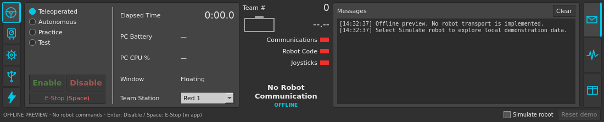
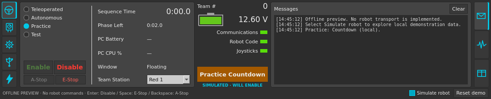

# DriveStation Linux

Reimplementação independente para Linux da **NI FRC Driver Station**, com foco
em fidelidade visual e funcional à experiência usada com **roboRIO**.

**Estado atual: prévia desktop com Practice local.** A interface permite navegar
pelas abas, salvar preferências e executar uma sequência de prática demonstrativa
com A-Stop. Comunicação com roboRIO e leitura de controles físicos ainda não
foram implementadas.



## Objetivo

Permitir que equipes FRC usem Linux mantendo uma experiência próxima da Driver
Station da NI: disposição dos controles, indicadores, modos de operação,
joysticks, diagnóstico e configuração.

A fidelidade será avaliada em duas frentes: comparação da interface com a
referência e testes do comportamento com simuladores e, posteriormente, com
roboRIO. Cada recurso terá seu estado registrado na
[matriz de fidelidade](docs/fidelidade.md).

## Referência do projeto

A referência inicial é a **NI FRC Driver Station da temporada 2026 para
roboRIO**. A versão exata do aplicativo usada nas comparações ainda será
registrada. Não há código-fonte da NI incorporado neste repositório.

A [FIRST Driver Station anunciada para 2027][nova-ds] já oferece suporte a Linux,
mas foi projetada para Systemcore e não é compatível com roboRIO. Este projeto
tem como alvo a experiência anterior da NI e o ecossistema roboRIO.

## Compilar e executar

Dependências: compilador C++17, CMake 3.21 ou posterior, Ninja e os módulos
Widgets e Test do Qt 6.4 ou posterior. Não há downloads automáticos no build.
O ambiente validado até agora é Arch Linux x86_64 com Qt 6.12.0 e GCC 16.2.1.
A versão mínima declarada do Qt ainda não foi testada.

```sh
cmake -S . -B build -G Ninja -DCMAKE_BUILD_TYPE=Release
cmake --build build --parallel
ctest --test-dir build --output-on-failure
./build/drivestation-linux
```

Para instalar no diretório do usuário:

```sh
cmake --install build --prefix "$HOME/.local"
```

O binário será instalado em `~/.local/bin`, junto de um atalho de desktop e um
ícone nos diretórios correspondentes. O binário depende do Qt instalado.

## Usar a prévia

- As abas à esquerda são Operation, Diagnostics, Setup, USB Devices e CAN/Power.
- À direita, Messages, Charts e Both alternam a visualização.
- Setup salva equipe, dashboard, dados de jogo e tempos de prática. A seleção
  de dashboard é uma preferência; não inicia outro aplicativo neste marco.
- **Simulate robot** ativa dados gerados localmente. Enable/Disable e E-Stop
  alteram apenas essa demonstração. Não são enviados comandos ao robô.
- `Enter` desabilita a demonstração; `Space` trava E-Stop dentro da aplicação.
  Segurar `[`, `]` e `\` habilita a demonstração fora dos campos de texto.
- **Reset demo** limpa a sessão e a desconecta. Reconectar, mudar modo, equipe
  ou estação não reabilita a demonstração automaticamente.

## Practice na demonstração

Ative **Simulate robot**, selecione **Practice** e pressione **Enable**. Os tempos
de Setup controlam os cinco segmentos consecutivos: Countdown → Autonomous →
Delay → Teleoperated → End Game. O último segmento continua em Teleop. Os padrões
existentes são preservados; eles não definem as regras de duração de uma temporada.

Countdown e Delay ficam desabilitados. Os outros segmentos habilitam a sessão
local e a sequência termina desabilitada. **Sequence Time** inclui as esperas;
**Phase Left** mostra o tempo restante do segmento.

O botão **A-Stop** e `Backspace`, fora dos campos de texto, interrompem somente
Autonomous. O relógio continua e Teleop retoma automaticamente. O status laranja
e **WILL ENABLE** indicam habilitação futura.

**Disable** ou `Enter` cancelam tudo, inclusive Countdown e A-Stop. E-Stop,
desconexão, perda de ativação da janela, fechamento, troca de modo, equipe,
estação ou tempos também interrompem a execução. Um atraso de atualização maior
que um segundo cancela a sessão em vez de avançar silenciosamente pelas fases.
Nada é retomado sem um novo Enable explícito, exceto a retomada prevista de um
A-Stop ainda em execução.



Veja as capturas de [A-Stop](docs/images/practice-astop.png) e
[Teleop retomado](docs/images/practice-teleop.png), a
[decisão de comportamento](docs/decisoes/0002-practice-local.md) e a
[validação](docs/validacao-practice.md).

O aplicativo inicia desconectado e desabilitado. Estado de conexão, habilitação
e E-Stop não são persistidos. As preferências usam `QStandardPaths` e ficam,
normalmente, em `~/.config/DriveStationLinux/drivestation-linux/settings.ini`.

```sh
./build/drivestation-linux --demo --tab usb --view both
./build/drivestation-linux --config /tmp/drivestation-settings.ini
QT_QPA_PLATFORM=offscreen ./build/drivestation-linux --screenshot /tmp/drivestation-preview.png
```

`--screenshot` requer um caminho novo e preserva arquivos existentes.
Veja também [Setup](docs/images/setup.png) e [USB com dados simulados](docs/images/usb-demo.png).

## Desenvolvimento e limitações

O painel tem 224 pixels lógicos de altura, incluindo o aviso da prévia, e largura
mínima de 1024 pixels. O layout usa como referência inicial as imagens da
documentação WPILib, que incluem versões anteriores da NI; a comparação com uma
versão exata da NI 2026 continua pendente.

Não há captura de teclado fora da aplicação, descoberta de USB, rumble,
integração com dashboards, encaixe automático da janela ou
transporte para robôs. Campos sem fonte de dados exibem indisponibilidade.
Sons de Practice, suspensão física e a paridade exata com a NI ainda não foram
validados. O núcleo de operação real e o protocolo terão testes próprios.

- [Matriz de fidelidade](docs/fidelidade.md)
- [Plano de desenvolvimento](docs/roadmap.md)
- [Referências técnicas](docs/referencias.md)
- [Decisão de stack e critérios da prévia](docs/decisoes/0001-desktop-qt.md)
- [Validação da primeira prévia](docs/validacao-previa.md)

## Identidade e escopo

Projeto comunitário independente, sem vínculo oficial com NI, FIRST ou WPILib.
Uso em eventos e integração com FMS não fazem parte da validação inicial.
Compatibilidade e resultados de testes serão documentados conforme forem
comprovados.

[nova-ds]: https://wpilib.org/blog/the-2027-first-driver-station
